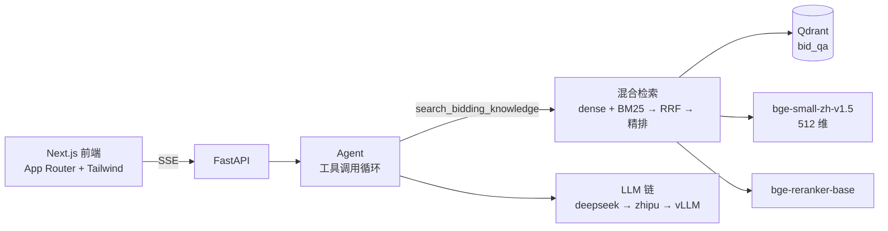

## 项目名称

招投标智能问答机器人（第一阶段：RAG）

基于检索增强生成的招投标 / 政府采购领域问答系统。把 Excel 中的问答语料入库到向量库，
用「稠密语义 + BM25 关键词」混合检索召回、CrossEncoder 精排，再交给可自动回退的大模型
流式作答，并在界面上展示参考来源。

**检索已注册为工具**：Agent 会根据问题自行判断是否需要查知识库——问招投标业务问题
会先检索再作答并标注出处，闲聊则直接回答。检索过程在界面上可见。

> 当前为第一阶段，只实现基础 RAG。第二阶段（Neo4j 知识图谱、PostgreSQL 会话记录、
> Tavily / Exa 联网搜索）已在 `.env` 中预留配置并写好接口桩，尚未实现。

## 运行条件

| 组件 | 版本 | 说明 |
|---|---|---|
| Python | **3.12** | 已在 `.python-version` 锁定；3.13+ 缺少部分 ML 轮子 |
| uv | 0.12+ | Python 包与虚拟环境管理 |
| Node.js | 20+ | 前端运行时（开发时实测 24.x） |
| npm | 10+ | 前端包管理 |
| Qdrant | Cloud 或本地 | 需要 **Named Vectors + Prefetch/RRF**（1.10+，实测云服务 1.19.1） |

安装依赖：

```bash
uv sync                    # 后端（含 torch，首次约 1GB）
cd frontend && npm install # 前端
```

**模型权重**：`BAAI/bge-small-zh-v1.5`（约 100MB）与 `BAAI/bge-reranker-base`（约 1.1GB）
首次运行会自动下载。`.env` 里已配置 `HF_ENDPOINT=https://hf-mirror.com`——
国内直连 huggingface.co 会超时，该镜像地址是下载能成功的前提。

## 运行说明

1. **配置**：`.env` 已包含全部所需配置（LLM 密钥、Qdrant 地址、模型名等）。该文件不入库。

2. **检查依赖连通性**（可选但推荐）：

   ```bash
   uv run bidding-qa-chatbot check
   ```

3. **初始化数据库**（首次必做，需要 PostgreSQL）：

   ```bash
   # .env 里的 POSTGRES_PASSWORD 需填真实密码
   uv run alembic upgrade head
   ```

   账号与对话历史存在这里。详见 `docs/database.md`。

4. **语料入库**（首次必做）：

   ```bash
   uv run bidding-qa-chatbot ingest
   ```

   会读取 `data/processed/问题答案样例数据0113.xlsx`（80 条问答 + 3 张内嵌图片），
   用视觉模型解析图片内容，编码后写入 Qdrant。重复执行是幂等的。

5. **启动后端**：

   ```bash
   uv run bidding-qa-chatbot serve          # http://127.0.0.1:8001 ，文档 /docs
   ```

6. **启动前端**（另开终端）：

   ```bash
   cd frontend && npm run dev               # http://localhost:3000
   ```

   前端通过 Next 的 `rewrites` 把 `/api/*` 代理到后端，同源、无需 CORS 配置。

## 测试说明

```bash
uv run pytest                      # 全部（离线，不需要任何密钥或云服务）
uv run pytest tests/test_bm25.py   # 单个文件
uv run pytest tests/test_bm25.py::test_idf_is_always_positive   # 单个用例
uv run ruff check . && uv run ruff format --check .
```

测试**完全离线**：LLM 调用用 `respx` 拦截或假 provider 替代，向量库用
`QdrantClient(":memory:")`，不会触碰真实 API 与付费额度。因此 CI 不需要任何密钥。

需要真实模型权重的用例标记为 `model`，默认跳过：

```bash
RUN_MODEL_TESTS=1 uv run pytest -m model
```

## 技术架构



| 层 | 技术 |
|---|---|
| 后端 | FastAPI + Uvicorn + Pydantic v2 |
| 前端 | Next.js（App Router）+ React + TypeScript + TailwindCSS v4 |
| 向量库 | Qdrant Named Vectors 混合检索（Prefetch + RRF） |
| 嵌入 / 精排 | `BAAI/bge-small-zh-v1.5`（512 维）/ `BAAI/bge-reranker-base` |
| 稀疏检索 | jieba 分词 + BM25（自实现，词表持久化） |
| 大模型 | DeepSeek（OpenAI SDK）+ 智谱（zai-sdk），失败自动回退 |
| 视觉解析 | `glm-4.6v-flashx`（解析语料内嵌图片） |
| 文档渲染 | react-markdown + remark-gfm（含 GFM 表格） |

更详细的说明见 `docs/`：架构、入库、检索、API、前端、开发、部署。

## 协作者

<!-- 在此登记协作者 -->
