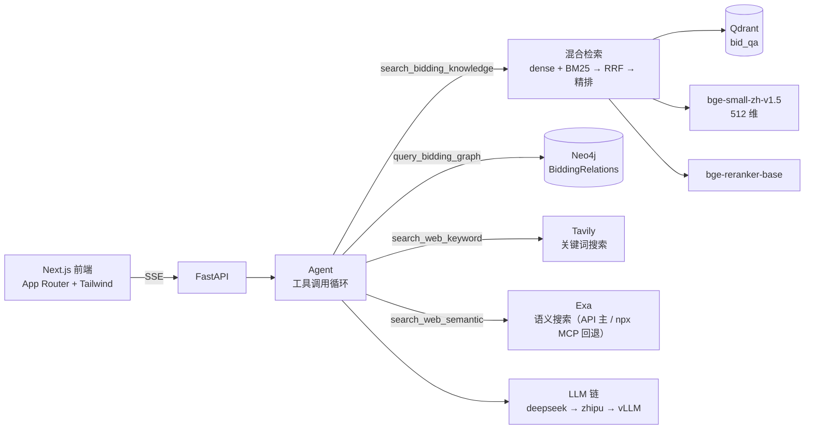

## 项目名称

招投标智能问答机器人

基于检索增强生成 + 知识图谱 + 联网搜索的招投标 / 政府采购领域问答系统。把 Excel 中的
问答语料入库到向量库，用「稠密语义 + BM25 关键词」混合检索召回、CrossEncoder 精排；
招投标交易事实（标的物交易频次、中标金额、供应商/采购人/代理机构/地区关联）存在
Neo4j 知识图谱里；时效性强的外部公开信息可以开启联网搜索。全部能力都注册为 Agent 工具，
由大模型根据问题自行选择，再交给可自动回退的 LLM 流式作答，并在界面上展示参考来源
（本地知识库 / 联网搜索分区）与工具调用过程。

**附件上传与解析**：消息可携带 PNG/JPEG/WebP/PDF/DOCX 附件；发送时由本地 Ollama 的
GLM-OCR 解析（PDF 逐页渲染、DOCX 提取正文与内嵌图片），解析结果与用户问题一起交给 LLM。
附件随消息持久化，同一会话的后续追问会自动带上最近附件的 OCR 内容。

**四个工具，按问题类型自动路由**：

- `search_bidding_knowledge`——法规条款、期限、门槛、资格条件等规范性知识（检索 + 标注出处）；
- `query_bidding_graph`——具体交易事实与统计（先查 Neo4j，再依据查询结果作答）；
- `search_web_keyword`——Tavily 关键词联网搜索（用户开启「联网搜索」后可用）；
- `search_web_semantic`——Exa 语义联网搜索（Exa HTTP API 为主、npx MCP 回退）。

> 状态：RAG 检索、账号与对话历史（PostgreSQL）、知识图谱查询（Neo4j，`ENABLE_NEO4J=true`）、
> 联网搜索（`ENABLE_WEB_SEARCH=true`）、附件上传与 GLM-OCR 解析均已实现。图谱数据由
> `data/batch/to_neo4j.py` 注入（可重复执行）。

## 运行条件

| 组件 | 版本 | 说明 |
|---|---|---|
| Python | **3.12** | 已在 `.python-version` 锁定；3.13+ 缺少部分 ML 轮子 |
| uv | 0.12+ | Python 包与虚拟环境管理 |
| Node.js | 20+ | 前端运行时；后端 Exa 的 MCP 回退也通过 npx 拉起（主路径是 Exa HTTP API） |
| npm | 10+ | 前端包管理 |
| Qdrant | Cloud 或本地 | 需要 **Named Vectors + Prefetch/RRF**（1.10+，实测云服务 1.19.1） |
| Ollama | 0.30+ | 附件 OCR 需要本地 `glm-ocr:latest`（`ollama pull glm-ocr`）；无需 GPU，CPU 可跑 |

安装依赖：

```bash
uv sync                    # 后端（含 torch，首次约 1GB）
cd frontend && npm install # 前端
```

**模型权重**：`BAAI/bge-small-zh-v1.5`（约 100MB）与 `BAAI/bge-reranker-base`（约 1.1GB）
首次运行会自动下载。`.env` 里已配置 `HF_ENDPOINT=https://hf-mirror.com`——
国内直连 huggingface.co 会超时，该镜像地址是下载能成功的前提。

## 运行说明

1. **配置**：`.env` 已包含全部所需配置（LLM 密钥、Qdrant 地址、模型名等）。该文件不入库。

2. **检查依赖连通性**（可选但推荐）：

   ```bash
   uv run bidding-qa-chatbot check
   ```

3. **初始化数据库**（首次必做，需要 PostgreSQL）：

   ```bash
   # .env 里的 POSTGRES_PASSWORD 需填真实密码
   uv run alembic upgrade head
   ```

   账号与对话历史存在这里。详见 `docs/database.md`。

4. **语料入库**（首次必做）：

   ```bash
   uv run bidding-qa-chatbot ingest
   ```

   会读取 `data/processed/问题答案样例数据0113.xlsx`（80 条问答 + 3 张内嵌图片），
   用视觉模型解析图片内容，编码后写入 Qdrant。重复执行是幂等的。

5. **知识图谱入库**（可选；需要图谱问答时必做）：

   ```bash
   # .env 配好 NEO4J_* 并设 ENABLE_NEO4J=true
   uv run python data/batch/to_neo4j.py
   ```

   读取 `data/processed/` 下的两份 CSV（标的物交易频次、招标采购标的物信息），
   注入 Neo4j 的 `BiddingRelations` 库。重复执行是幂等的。

6. **启动后端**：

   ```bash
   uv run bidding-qa-chatbot serve          # http://127.0.0.1:8001 ，文档 /docs
   ```

7. **启动前端**（另开终端）：

   ```bash
   cd frontend && npm run dev               # http://localhost:3000
   ```

   前端通过 Next 的 `rewrites` 把 `/api/*` 代理到后端，同源、无需 CORS 配置。

## 测试说明

```bash
uv run pytest                      # 全部（离线，不需要任何密钥或云服务）
uv run pytest tests/test_bm25.py   # 单个文件
uv run pytest tests/test_bm25.py::test_idf_is_always_positive   # 单个用例
uv run ruff check . && uv run ruff format --check .
```

测试**完全离线**：LLM 调用用 `respx` 拦截或假 provider 替代，向量库用
`QdrantClient(":memory:")`，不会触碰真实 API 与付费额度。因此 CI 不需要任何密钥。

需要真实模型权重的用例标记为 `model`，默认跳过：

```bash
RUN_MODEL_TESTS=1 uv run pytest -m model
```

## 技术架构



| 层 | 技术 |
|---|---|
| 后端 | FastAPI + Uvicorn + Pydantic v2 |
| 前端 | Next.js（App Router）+ React + TypeScript + TailwindCSS v4 |
| 向量库 | Qdrant Named Vectors 混合检索（Prefetch + RRF） |
| 知识图谱 | Neo4j（异步驱动；参数化模板 + 只读 Cypher 兜底，读事务执行） |
| 联网搜索 | Tavily（关键词，basic 深度 + 进程内缓存）/ Exa（语义，HTTP API 为主、npx MCP 回退） |
| 嵌入 / 精排 | `BAAI/bge-small-zh-v1.5`（512 维）/ `BAAI/bge-reranker-base` |
| 稀疏检索 | jieba 分词 + BM25（自实现，词表持久化） |
| 大模型 | DeepSeek（OpenAI SDK）+ 智谱（zai-sdk），失败自动回退 |
| 视觉解析 | `glm-4.6v-flashx`（解析语料内嵌图片） |
| 附件解析 | 本地 Ollama `glm-ocr:latest`（原生 `/api/generate`）；PDF 用 PyMuPDF 渲染、DOCX 用 python-docx |
| 文档渲染 | react-markdown + remark-gfm（含 GFM 表格） |

更详细的说明见 `docs/`：架构、入库、检索、API、前端、开发、部署。

## 协作者

<!-- 在此登记协作者 -->
