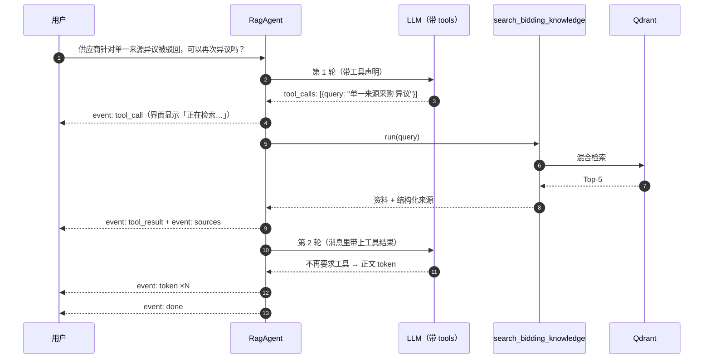

# Agent 与工具

把 RAG 检索注册成工具，由模型自行决定**何时**调用。用户问招投标问题时，
Agent 会自动检索知识库再作答；与业务无关的闲聊则直接回答，不做无谓检索。

## 一次问答的流程



模型可能**一轮里并行发起多个检索**（实测常见：先查主问题、再补一个限定词），
每个都会执行并把结果一并回灌。

## 两个刻意的设计

### 1. 最后一轮强制去掉工具

`agent_max_steps`（默认 3）用尽的那一轮，请求里**不带 `tools`**：

```python
is_last = step == max_steps - 1
tools = None if is_last else schemas
```

否则模型可能一直要求检索、永远不给答案，用户什么都拿不到。
真出现「没工具也硬要调用」的异常 provider，循环会以
`finish_reason="max_steps"` 明确收尾，而不是静默卡住（有测试覆盖）。

### 2. 工具失败不打断对话

工具抛异常、参数不对、模型编造了不存在的工具名——这些**都不向上抛**，
而是转成一条错误信息回灌给模型，让它自己调整：

```
错误：工具 search 的参数不正确（unexpected keyword argument）。请检查参数后重试。
```

对用户而言这是一次正常的（可能稍慢的）回答，而不是 500。

## 工具契约

```python
class Tool(Protocol):
    spec: ToolSpec  # name / description / JSON Schema

    async def run(self, **kwargs) -> ToolResult: ...
```

`ToolResult.content` 回灌给模型；`ToolResult.artifacts` 放结构化数据
（如引用来源），**模型看不到**，只用于推给前端。两者分开是必要的——
给模型的是便于阅读的文本，给前端的是可直接渲染的结构。

新增工具只需实现协议并注册到 `build_default_registry()`，Agent 循环无需改动。

### `description` 是唯一的决策依据

`RagSearchTool` 的描述没有停留在「这是什么」，而是写清了**什么时候必须用**：
涉及法规条款、期限、金额门槛、资格条件的问题都要先查知识库。
招投标是垂直领域，模型自身记忆里的法规时效和金额档位极不可靠。

## 三个踩过的坑

1. **`reasoning_content` 必须回传。** DeepSeek 要求：带 `tool_calls` 的
   assistant 消息若丢掉 `reasoning_content`，后续请求会被 400 拒绝。
   `ChatMessage.to_dict()` 里做了这条处理。

2. **「provider 没产出内容」的判据要算上工具调用。** `chain.py` 里原本只统计
   文本 token，于是**只返回 tool_calls、正文为空**的正常轮次被判成失败
   （`MidStreamError: provider 未产出任何内容`）。现已把 `tool_calls` 计入有效产出。

3. **调用工具前的前言会混进回答。** 模型有时先来一句
   「I'll look this up in the knowledge base.」再发起调用，这段文字会被当成正文
   流式发给用户。已在系统提示词里明确禁止输出过渡语。

## 配置

| 变量 | 默认 | 说明 |
|---|---|---|
| `AGENT_ENABLED` | `true` | 关闭后回到「先固定检索、再生成」的老路径 |
| `AGENT_MAX_STEPS` | `3` | 工具调用轮数上限 |

关掉 Agent 会少一次模型往返（更快），但也就失去了「由模型判断是否需要检索」的能力——
闲聊类问题也会白白走一遍检索。保留这个开关主要是为了出问题时能一键退回。

## 本地模型缺失时的行为

**只要 `AGENT_ENABLED=true` 就建立 Agent，不因本地编码器/精排模型缺失而跳过。**

这两个是正交的关注点：

| | 决定什么 | 缺失时的影响 |
|---|---|---|
| Agent | **由谁**判断要不要检索 | — |
| 本地模型 | 工具内部**能不能**跑 | 检索失败，但 Agent 照常工作 |

曾经写成「本地模型没就绪 → 回退到固定检索路径」，这是错的，而且**有害**：
固定检索路径在缺 encoder 时是**直接 503** 的。所谓「回退」实际是把
「部分可用」（模型仍能回答闲聊、并如实告知知识库不可用）变成了「完全不可用」。

现在的做法：工具返回一条可转述的失败信息——

```
知识库检索当前不可用：本地嵌入模型未就绪，无法进行语义编码。
请如实告知用户知识库暂时无法访问，不要凭自身记忆回答法规、期限或金额类问题。
```

模型据此如实作答。**注意仍然注册这个工具**而不是干脆不给模型：
不注册的话模型会转而凭自身记忆回答招投标问题——在本领域里，
编造法规条款和时限比「答不出来」危险得多。

## 前端呈现

`tool_call` / `tool_result` 两个 SSE 事件驱动界面上的检索过程提示。
**这段过程必须可见**：检索加二轮生成要好几秒，如果界面毫无反馈，
用户会以为卡住了。参考来源面板由 `tool_result` 携带的 `sources` 填充。
