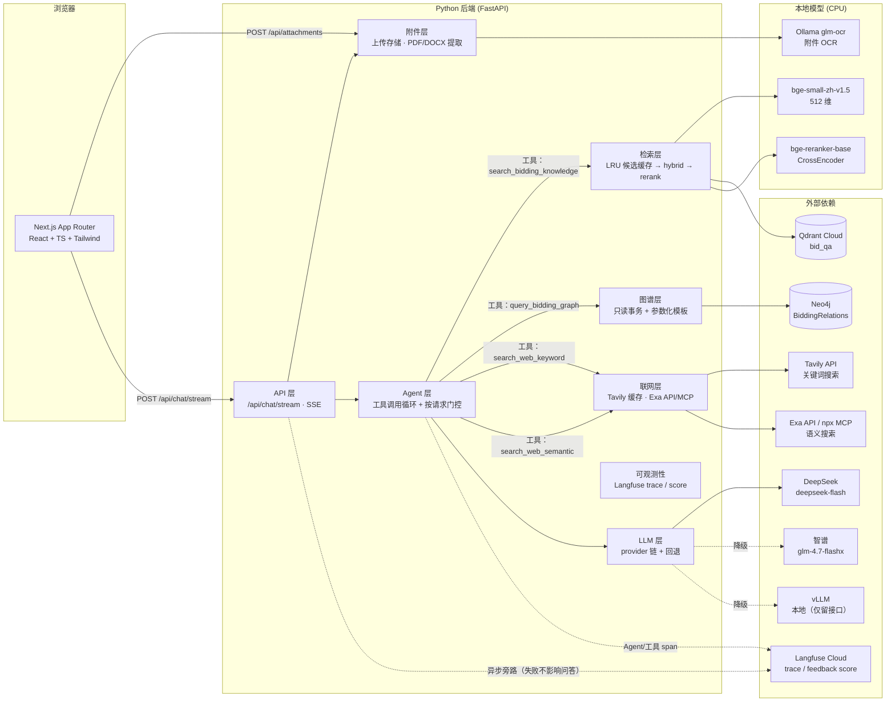
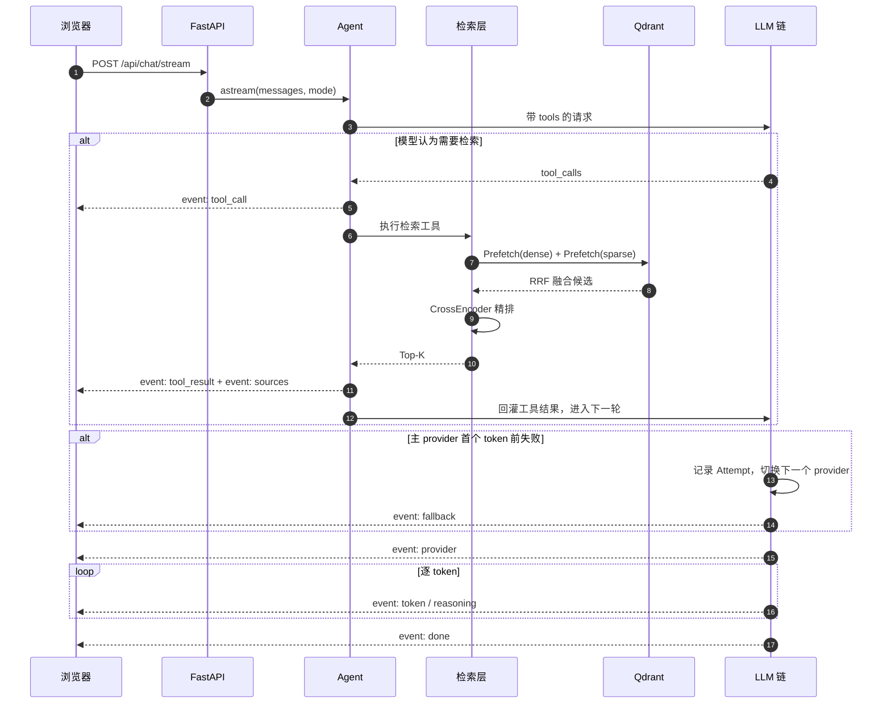

# 系统架构

问答语料入库到 Qdrant（稠密 + 稀疏混合检索、CrossEncoder 精排），招投标交易事实
（标的物交易频次、中标金额、供应商/采购人/代理机构/地区关联）注入 Neo4j 知识图谱，
时效性强的外部公开信息可开启联网搜索（Tavily 关键词 / Exa 语义）。它们都注册为 Agent
工具，由可切换的 LLM 根据问题自行选择，流式作答并在前端展示参考来源（本地/联网分区）
与工具调用过程。用户还可以上传图片/PDF/DOCX 附件，由本地 Ollama GLM-OCR 在发送时解析，
解析文本与问题一起进入 LLM 上下文。

## 一次问答的时序

注意 `sources` 事件在**任何 LLM 调用之前**发出——这样「展示参考来源」这一需求
不依赖 LLM 的健康状况，即使所有模型都挂了，检索结果照样能显示。

> 老路径（`AGENT_ENABLED=false`）没有 Agent 与工具调用这两步：
> 先固定检索、把资料塞进提示词，再直接生成。此时 `sources` 事件在
> 任何 token 之前发出；Agent 路径下来源要等 `tool_result` 才出现。

## 为什么这样分层

- **`agent/` 单独成层**：它编排「模型 ↔ 工具」的往返，不关心检索内部怎么实现，
  也不关心用的是哪家 LLM。新增工具只碰 `agent/`（实现 + 在 `registry.py` 注册），
  检索与模型两侧都不用动。
- **`llm/`、`embeddings/`、`retrieval/`、`graph/` 分开放**：四者失败模式和伸缩性完全不同。
  LLM 挂了不该拖垮检索；检索要能在「假编码器」下独立测试；图谱查询失败只该让一个工具失败。
- **`graph/` 独立于 `retrieval/`**：数据形态不同（结构化关系 vs 文档片段），
  访问方式不同（只读事务 + Cypher vs 向量检索），失败语义也不同——
  混在一起会让「检索降级」这种精细处理被图谱的连接问题污染。
- **`web/` 单独成层**：两个引擎的可用性、超时、缓存与降级各成体系（Tavily 有进程内缓存；
  Exa 以 HTTP API 为主、npx MCP 为回退），且只在用户开启时才会被模型看到——
  与检索/图谱共用工具协议，但不共享任何实现细节。
- **`attachments/` 单独成层**：上传存储/所有权校验、三种格式的文件提取、以及
  「本轮 + 历史附件」的提示词上下文组装互不耦合；OCR 由 `llm/ocr.py` 的本地
  Ollama 客户端提供，**不接入 ProviderChain**（冷启动可达 ~2 分钟，且不是文本兜底候选）。
  解析发生在会话落库之前，失败不会留下空会话或半条用户消息。
- **`ingestion/` 与 `retrieval/` 分离**：入库是批处理 + CLI，检索是每请求异步，
  两者只共享 `ids.py` 和 `qdrant_store.py`。图谱入库同理放在 `data/batch/to_neo4j.py`
  （离线脚本，不入包）。
- **`schemas.py` 放在顶层而非 `api/` 下**：SSE 事件模型被 API 层和前端
  `lib/types.ts` 同时消费，线上格式只有一个地方可查。
- **`integrations/` 已移除**：第二阶段全部实现后（PostgreSQL → `db/`，Neo4j → `graph/`，
  联网搜索 → `web/`），不再有需要集中摆放的接口桩。

## 关键约束（改代码前必读）

1. **`load_dotenv(override=False)` 必须早于任何 `huggingface_hub` / `sentence_transformers`
   的导入。** 本机无法直连 huggingface.co，`HF_ENDPOINT` 指向 hf-mirror 才能下载模型。
   `embeddings/*` 因此全部使用函数内延迟导入。
2. **`pyproject.toml` 里的 `[project.scripts]` 指向 `bidding_qa_chatbot:main`**，
   `main()` 必须留在 `__init__.py`。
3. **`openai` 锁在 2.x**：3.x 改用 `httpx2` 并不再依赖 `httpx`，
   会导致 respx/pytest-httpx 无法拦截，mock 测试会静默打到线上付费 API。
4. **Windows 下所有文件 IO 显式 `encoding="utf-8"`**：本机 locale 是中文，
   Python 默认用 GBK，读中文语料或打印中文会直接崩。
