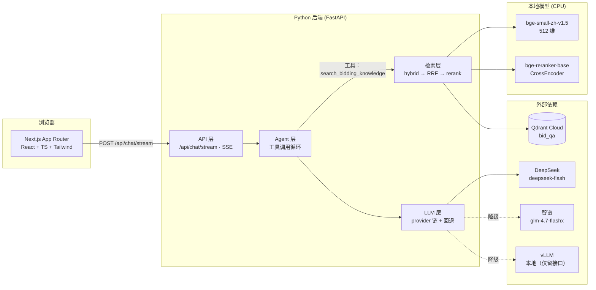
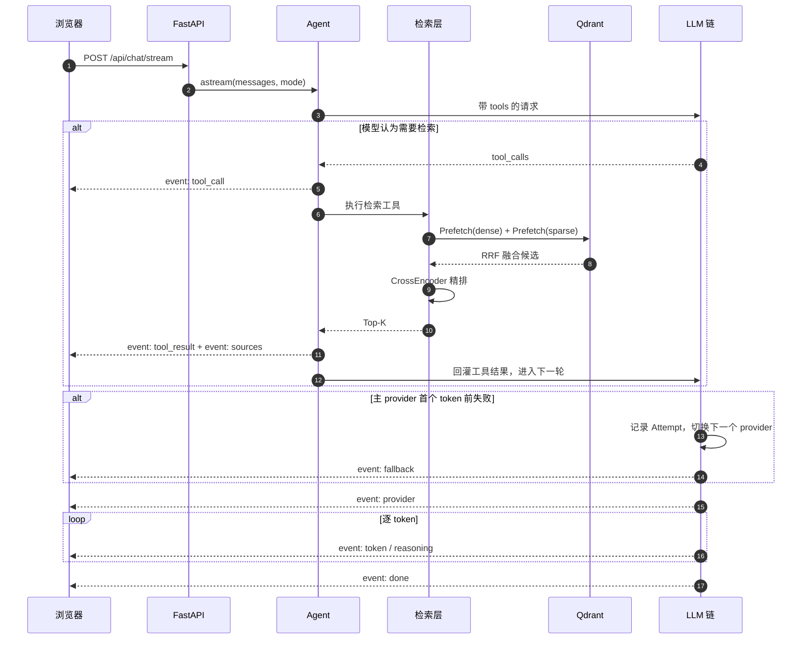

# 系统架构

第一阶段只做 RAG：把 Excel 里的问答语料入库到 Qdrant，用「稠密 + 稀疏」混合检索召回，
CrossEncoder 精排，再交给可切换的 LLM 流式作答，并在前端展示参考来源。

## 一次问答的时序

注意 `sources` 事件在**任何 LLM 调用之前**发出——这样「展示参考来源」这一需求
不依赖 LLM 的健康状况，即使所有模型都挂了，检索结果照样能显示。

> 老路径（`AGENT_ENABLED=false`）没有 Agent 与工具调用这两步：
> 先固定检索、把资料塞进提示词，再直接生成。此时 `sources` 事件在
> 任何 token 之前发出；Agent 路径下来源要等 `tool_result` 才出现。

## 为什么这样分层

- **`agent/` 单独成层**：它编排「模型 ↔ 工具」的往返，不关心检索内部怎么实现，
  也不关心用的是哪家 LLM。新增工具只碰 `agent/`，检索与模型两侧都不用动。
- **`llm/`、`embeddings/`、`retrieval/` 分开放**：三者失败模式和伸缩性完全不同。
  LLM 挂了不该拖垮检索；检索也要能在「假编码器」下独立测试。
- **`ingestion/` 与 `retrieval/` 分离**：入库是批处理 + CLI，检索是每请求异步，
  两者只共享 `ids.py` 和 `qdrant_store.py`。
- **`schemas.py` 放在顶层而非 `api/` 下**：SSE 事件模型被 API 层和前端
  `lib/types.ts` 同时消费，线上格式只有一个地方可查。
- **`integrations/` 单独成目录**：第二阶段的东西集中放，一眼能看出「还没实现」。

## 关键约束（改代码前必读）

1. **`load_dotenv(override=False)` 必须早于任何 `huggingface_hub` / `sentence_transformers`
   的导入。** 本机无法直连 huggingface.co，`HF_ENDPOINT` 指向 hf-mirror 才能下载模型。
   `embeddings/*` 因此全部使用函数内延迟导入。
2. **`pyproject.toml` 里的 `[project.scripts]` 指向 `bidding_qa_chatbot:main`**，
   `main()` 必须留在 `__init__.py`。
3. **`openai` 锁在 2.x**：3.x 改用 `httpx2` 并不再依赖 `httpx`，
   会导致 respx/pytest-httpx 无法拦截，mock 测试会静默打到线上付费 API。
4. **Windows 下所有文件 IO 显式 `encoding="utf-8"`**：本机 locale 是中文，
   Python 默认用 GBK，读中文语料或打印中文会直接崩。
