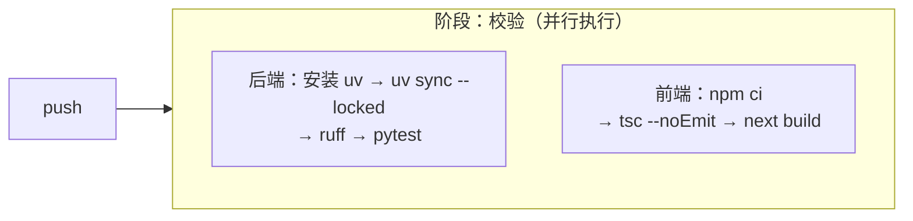

# CI/CD 与部署

## 为什么不是 GitHub Actions

本仓库的 `origin` 是 `codeup.aliyuncs.com`，GitHub Actions 在这里不会被触发。
流水线用**阿里云云效 Flow**。

## 流水线配置在哪里

**这一点与常见 CI 不同，容易误解：**

选择「YAML 化编排」后，控制台**不再提供流水线源等可视化配置**，只提供一个
YAML 输入框。也就是说：

- 流水线的**唯一事实来源是控制台里那份 YAML**；
- 仓库里的 `.workflow/ci.yml` 只是**本地底稿**，不会被流水线读取；
- 因此该文件**不入库**（见 `.gitignore` 的 `/.workflow/`）。

改动流程是：改本地底稿 → 整份粘贴回控制台 → 保存。

## 三个硬约束（实测踩过）

### 1. `runsOn` 不能用简写

2025 年 4 月 1 日之后创建的组织**不再支持** `runsOn: public/cn-beijing` 这种简写，
必须写完整的 `group` + `container`，且 `group` 的值固定为 `public/cn-hangzhou`：

```yaml
runsOn:
  group: public/cn-hangzhou
  container: build-steps-public-registry.cn-hangzhou.cr.aliyuncs.com/build-steps/alinux3:latest
```

### 2. `serviceConnection` 必须是 UUID 字面值

`certificate.serviceConnection` **无法用控制台变量注入**，只能直接写服务连接 UUID。

原因：`sources` 属于**解析期**就要确定的结构性字段，而流水线变量
（`variables` 里的 `${key}`）生效范围仅限 step 的 `with` 参数内部，
无法向上回溯到 `sources` 层级。

这也是本文件不入库的直接原因——UUID 写进仓库等于公开内部标识。

### 3. 构建镜像是「裸」的，运行时都得自己装

`alinux3:latest` 只是基础 Linux 镜像，**既没有 uv 也没有 Node.js**，
而且 `$ENV_FILE` 变量在该镜像里**未定义**。两个具体后果：

**① 不要用 `$ENV_FILE` 传递 PATH。**
把 PATH 追加到 `$ENV_FILE` 会报 `$ENV_FILE: ambiguous redirect`（变量为空时
shell 无法解析重定向目标）。改为**每个步骤各自 export**：

```yaml
sync:
  step: Command
  with:
    run: |
      export PATH="$HOME/.local/bin:$PATH"   # uv 装在 $HOME/.local/bin
      uv sync --locked
```

注意 uv 与 Node 的差别：**uv 装到 `$HOME/.local/bin`（不在默认 PATH），
NodeSource 装到 `/usr/bin`（已在默认 PATH）**。所以后端每一步都要 export PATH，
前端安装后各步则不需要。

**② Node 必须先装。**

```yaml
install_node:
  step: Command
  with:
    run: |
      curl -fsSL https://rpm.nodesource.com/setup_20.x | bash -
      dnf install -y nodejs
      node --version && npm --version
```

不装就会在 `npm ci` 处报 `npm: command not found`。

## 流水线结构



只做**校验**，不产出制品、不部署（原因见下）。两个作业相互独立，会并行跑。

**这条流水线不需要任何密钥。** 后端测试全程离线：LLM 调用被 `respx` 拦截或换成假
provider，向量库用 `QdrantClient(":memory:")`，不触碰任何付费额度或云服务。
`/data` 与 `.env` 都被 `.gitignore` 排除，CI 里也不存在——依赖真实语料的用例自动跳过，
而 Excel 解析、图片锚点定位这些关键逻辑由 `tests/xlsx_builder.py`
**运行时现造**的 xlsx 覆盖（见 `docs/ingestion.md`）。

## 为什么没有打包/部署阶段

早期版本有一个 `package` 阶段，**已删除**，因为它当时是有害无益的：

1. 没有 `ArtifactUpload` 步骤，产物构建完就随容器销毁，等于白跑；
2. 前端构建在 `verify` 里已经做过一次，纯属重复劳动；
3. 第一阶段没有部署目标，产物无人消费；
4. YAML 模式下**无法把阶段设为手动触发**（控制台不提供该入口），
   所以它会在每次 push 时都白跑一遍。

等确定部署目标后，再连同 `ArtifactUpload` / `VMDeploy` 一起加回来。

## 本地能验证什么

```bash
uv run python -c "import yaml,io; yaml.safe_load(io.open('.workflow/ci.yml',encoding='utf-8'))"
```

只能确认 YAML 语法与结构（`sources` / `stages` / `jobs` / `steps` 都是**以 id 为键的
映射**，不是数组——写成数组会直接解析失败），**验证不了云效的 schema**。
最终以控制台保存时是否报错为准。

## 制品与部署

第一阶段**没有部署目标**，因此不做 CD。真要部署时需要先确定目标：

| 目标 | 需要的补充 |
|---|---|
| ECS 主机 | 主机组 + `VMDeploy` 步骤；需装 Python 3.12 与 Node 运行时（Node 20+ 也用于 Exa 的 npx MCP 回退；主路径只用 HTTPS API，不依赖 Node） |
| 容器服务 ACK | 先写 Dockerfile，构建镜像推 ACR，再部署 Deployment |
| 函数计算 FC | 后端需适配 FC 入口约定，前端可走静态托管 |

无论哪种，`.env` 都**不能进镜像或仓库**，要在部署环境注入。

## 部署前检查清单

- [ ] `.env` 未被打包进镜像 / 未提交
- [ ] `API_HOST` 按实际暴露方式调整（默认 `0.0.0.0`）
- [ ] `HTTP_TRUST_ENV` 按目标网络调整（有系统代理时见 `docs/development.md`）
- [ ] 模型权重已随镜像或数据卷预置——否则首次启动会去下载约 1.2GB
- [ ] `ENABLE_INGEST_ENDPOINT=false`（入库走 CLI，不暴露 HTTP）
- [ ] Qdrant Cloud 集群未因闲置被暂停
- [ ] 附件OCR：目标机已部署 Ollama 与 `glm-ocr:latest`，`OLLAMA_OCR_BASE_URL` 指向本机原生 API
- [ ] `DATA_DIR/uploads`（默认 `data/uploads`）放在持久化卷上；不要把该目录暴露为静态站点
