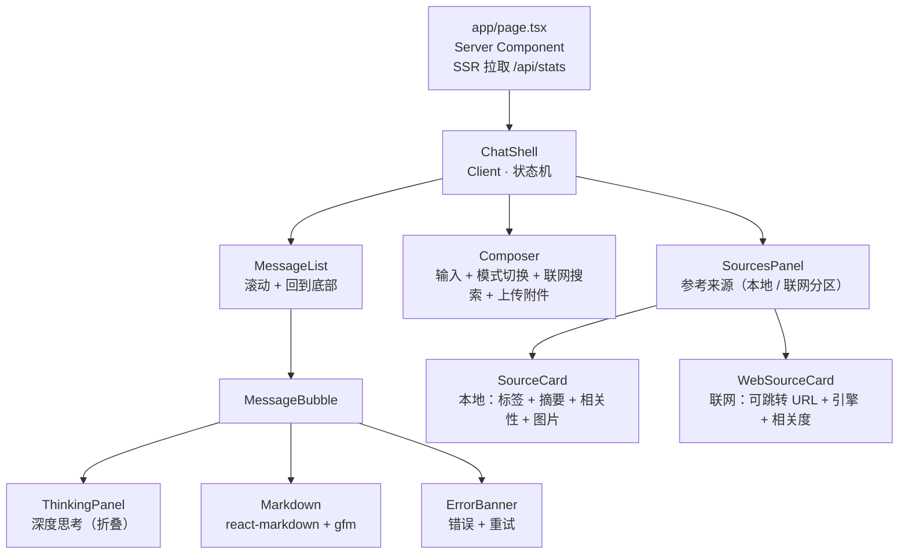

# 前端说明

## 组件结构



## Server / Client 边界

- **Server Component**：`app/layout.tsx`、`app/page.tsx`。
  `page.tsx` 真的 `await fetch('/api/stats')` 并 `cache: "no-store"`，
  页头因此是真正的 SSR，首屏就有集合名、provider 链、精排开关。
  后端不可用时 `fetchStats()` 返回 `null`，页头降级显示提示，**不会整页崩**。
- **Client Component**：所有持有流式状态的组件。
  流式状态无法跨 RSC 边界序列化。

**流一定从事件处理器里发起，绝不在 `useEffect` 里。**
React 严格模式会双调用副作用，从 effect 里开流会导致同一条消息请求两次。

## 开发代理

`/api/*` 由**路由处理器** `app/api/[...path]/route.ts` 转发到后端。

### 为什么不用 `next.config.ts` 的 `rewrites`

`rewrites` 配置更短，但它**会缓冲 SSE 响应**——实测同一问题：

| 路径 | token 帧数 | 首帧 | 末帧 | 跨度 |
|---|---|---|---|---|
| 直连后端 :8001 | 149 | 2894ms | — | **650ms** |
| 经 `rewrites` 代理 | 44 | 2414ms | 2414ms | **0ms** |
| 经 route handler | 312 | 2967ms | — | **1415ms** |

`rewrites` 那一行 44 个帧**全部落在同一毫秒**：整个响应被缓冲后一次性吐出，
用户看到的就是「答案憋到最后一次性蹦出来，思考过程和正文一起出现」。

路由处理器把上游 `ReadableStream` **原样**交给 `Response`，
不 await、不 concat、不 transform，字节到达即转发。

**千万不要**在转发时写成 `await upstream.arrayBuffer()` 之类的缓冲式读取。
`npm run verify:ui` 里有一条专门检查（「存在中间态样本」），
已用负向测试确认它能抓到这种退化。

保留 `/api` 前缀，前端所有请求都是相对路径，浏览器看来同源，**不需要 CORS**。

注意 `.env` 里的 `API_HOST=0.0.0.0` 是**监听**地址，代理必须拨 `127.0.0.1`
（`route.ts` 里的 `API_ORIGIN`，默认 `http://127.0.0.1:8001`）。

### Next 16 的两个坑

1. **`params` 是 Promise**，必须 `await ctx.params`（旧版本是同步对象）。
2. **`dynamic` / `revalidate` / `fetchCache` 段配置已被移除**
   （启用 Cache Components 后），别再写 `export const dynamic = "force-dynamic"`。
   `runtime` 默认就是 `nodejs`，`edge` 已废弃。

## SSE 消费

浏览器原生 `EventSource` **只能 GET、不能带请求体**，而这里是 POST + JSON，
所以用 `fetch` + `ReadableStream` 手动解析（`lib/sse.ts`）。要点：

- 一次 `read()` 可能返回半个帧，必须跨读取缓冲（按 `\n\n` 切分并保留尾段）；
- `TextDecoder` 必须用 `{stream: true}`——中文是多字节，可能被切在两次读取之间；
- `:` 开头是注释行（后端每 15 秒的 `: ping` 心跳），忽略；
- 非 200 响应体是 JSON 错误，**不能当 SSE 解析**；
- `signal.aborted` 为真时静默返回，用户主动「停止」不该看到错误。

## 参考来源

`sources` / `web_sources` 事件在答案 token 之前或工具调用后到达，所以来源面板在答案
还在输出时就已经填好。面板分两段：

- **本地知识库**（`SourceCard`）：序号 → `source_label` → 命中的问题 → 三行摘要 →
  相关性条 → 图片缩略图。
- **联网搜索**（`WebSourceCard`，独立 testid `web-source-card`）：序号 → 可跳转标题
  （`target="_blank" rel="noreferrer"`）→ 域名 → 三行摘要 → 引擎徽标（Tavily/Exa）→
  相关度条。没有评分的 Exa MCP 回退结果不渲染评分条。

**只展示 `rerank_score`，且不称作「置信度」。**
`rrf_score` 是排名融合的产物，量纲与余弦相似度不同（本地模式还会归一化），
把它显示成百分比会误导用户。联网结果的 `score` 来自搜索引擎本身，语义不同，
因此单独分区展示，不与本地评分混排。

输入区底部有两个并排的开关：**深度思考**（默认关闭 = 快速模式，点击切换）与
**联网搜索**（服务端能力来自 `/api/stats` 的 `web_search_available`，不可用时置灰
并给出 tooltip）。两者状态都跨发送保持。

## 附件上传与解析

- 「发送」左侧是**仅图标**的上传附件按钮（`Paperclip`，`aria-label="上传附件"`），
  点击打开隐藏的 `<input type="file">`；支持 PNG/JPEG/WebP/PDF/DOCX。
- **选择即上传**：`POST /api/attachments`（multipart，不经 Next 任何缓冲）；chip 显示
  上传中/就绪/失败，可移除。**上传时不解析**——OCR 由后端在发送时执行。
- 发送时请求体带 `attachment_ids`；助手气泡在等待期间显示「正在解析附件…」
  （GLM-OCR 冷启动可达 ~2 分钟）。OCR 失败时后端返回 JSON 错误，chip 仍留在输入区可重试。
- 用户消息落库后，历史回载会带 `MessageOut.attachments`，气泡里渲染不可移除的附件 chip；
  OCR 文本不在前端出现。同一会话的后续追问由后端自动带上最近附件的 OCR 内容。
- 重试通过 `lastAttachmentIdsRef`/`lastAttachmentMetaRef` 保留附件 id 与元数据，
  不会因为清空输入区而丢失。

## 消息操作（复制 / 重新生成 / 反馈）

每条助手回答下方（非 streaming 且有内容时）有一行操作：

- **复制**：`navigator.clipboard.writeText`，成功后在按钮旁短暂显示「已复制」；
- **重新生成**：仅**最后一条**助手消息显示；调用同一个流式接口并带
  `regenerate_message_id`，后端原地更新该消息，前端把该 turn 重置为 streaming 状态后重放；
- **👍/👎**：`aria-pressed` 表示选中态；再次点击同一项清除反馈。请求失败时回滚乐观更新。

这些按钮都依赖持久化消息 id：历史消息来自 `MessageOut.id`，刚生成的消息来自
`done` 事件的 `message_id`（落库失败时为 null，此时只显示复制）。重新生成后原反馈会被清空。

## 分阶段用时

助手消息完成后，气泡下方显示（`data-testid="message-timings"`）：

```
总用时 12.3s · 思考 4.1s · 工具执行 2.0s · 生成回答 6.2s
```

- 用时由**后端测量并落库**（`messages.timings`，迁移 `0007`），`done.timings` 与历史
  `MessageOut.timings` 返回同一份数据：请求进入 → 结束为「总用时」；首个正文 token →
  结束为「生成回答」；各 `tool_result.elapsed_ms` 之和为「工具执行」；「思考」=
  总用时 − 工具执行 − 生成回答。
- 思考模式下的推理 token 计入「思考」，不计入「生成回答」；为 0 的阶段不显示。
- 刷新/跨会话恢复后仍然显示（来自历史消息）。旧后端没有 `timings` 时，前端退回本地
  `performance.now()` 测量；流被用户停止或出错（没有 `done`）时不显示。

## 深度思考

`reasoning` 事件渲染在**默认折叠**的面板里，且**按纯文本渲染**（`whitespace-pre-wrap`），
不走 Markdown：模型的思考过程经常包含未闭合的代码围栏或半截表格，
用 Markdown 渲染会把整个布局吃掉。

## Markdown 与表格

`react-markdown` + `remark-gfm`，样式通过 `components` prop 显式指定，
而不是引入 `@tailwindcss/typography`（v4 下没有 `prose` 类，插件又是另一个变量）。

表格外层包 `overflow-x-auto`：语料与图片转录都是表格式内容，
宽表必须能横向滚动，否则会把聊天栏撑破。

⚠️ **不要添加 `rehype-raw`。** 渲染内容来自大模型输出，属于不可信输入，
加了它模型就能注入任意 HTML。文件里有注释说明。

## Tailwind v4 注意事项

v4 是 **CSS-first**：

- **没有 `tailwind.config.js`**，生成它不会有任何效果；
- 入口是 `app/globals.css` 里的 `@import "tailwindcss";`
- 主题令牌写在 `@theme { ... }` 里；
- PostCSS 插件是 `@tailwindcss/postcss`。

## 中文输入法

`Composer` 用 `e.nativeEvent.isComposing` 判断组字状态：
用中文输入法时回车是「选词确认」，不应该触发发送。

## UI 冒烟验证（`npm run verify:ui`）

```bash
uv run bidding-qa-chatbot serve      # 终端 1
cd frontend && npm run dev           # 终端 2
cd frontend && npm run verify:ui     # 终端 3
```

用真实浏览器跑 9 项断言：模式切换、示例填入、Enter 发送、Shift+Enter 换行、
发送按钮唯一性、**流式渲染**、以及控制台无 hydration/React 报错。

**为什么必须用真浏览器**：本项目栽过两次，两次都是「服务端渲染正常、
curl 和静态检查看不出问题」的故障——

1. Next 16 拦截跨域开发资源 → 客户端 JS 不接管，**所有交互静默失效**；
2. `rewrites` 缓冲 SSE → 答案**不再逐字出现**。

这两类问题只有真浏览器能暴露。新增前端交互后请跑一遍。

浏览器优先用系统自带 Edge/Chrome（`channel`），**不需要下载 Chromium**
（国内网络下 `playwright install` 常常卡死）。都找不到时以退出码 2 结束，
表示「跑不了」，与「跑失败」（退出码 1）区分开——CI 里据此决定是否跳过。

流式检查的判据是「**是否存在中间态样本**」（长度既非 0 也非最终值），
而不是采样间隔：token 生成本来就快、网络还会合并小包，
用间隔判断会把正常的流式误判成缓冲。

## 类型同步

`lib/types.ts` 是 `src/bidding_qa_chatbot/schemas.py` 的**手工镜像**。
改了后端 schema 必须同步这里，`tests/test_contract_sync.py` 会在字段名不一致时失败。

不引入 codegen：只有几十行类型定义，生成器的维护成本高于收益。
