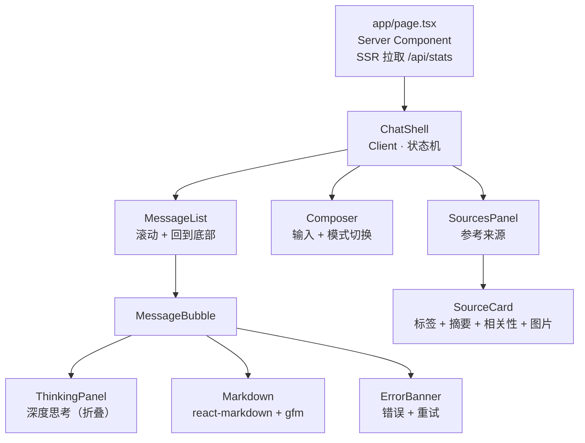

# 前端说明

## 组件结构



## Server / Client 边界

- **Server Component**：`app/layout.tsx`、`app/page.tsx`。
  `page.tsx` 真的 `await fetch('/api/stats')` 并 `cache: "no-store"`，
  页头因此是真正的 SSR，首屏就有集合名、provider 链、精排开关。
  后端不可用时 `fetchStats()` 返回 `null`，页头降级显示提示，**不会整页崩**。
- **Client Component**：所有持有流式状态的组件。
  流式状态无法跨 RSC 边界序列化。

**流一定从事件处理器里发起，绝不在 `useEffect` 里。**
React 严格模式会双调用副作用，从 effect 里开流会导致同一条消息请求两次。

## 开发代理

```ts
// next.config.ts
rewrites: [{ source: "/api/:path*", destination: `${API_ORIGIN}/api/:path*` }]
```

保留 `/api` 前缀，前端所有请求都是相对路径，浏览器看来同源，**不需要 CORS**。

注意 `.env` 里的 `API_HOST=0.0.0.0` 是**监听**地址，代理必须拨 `127.0.0.1`，
所以配置项是独立的 `API_ORIGIN`（默认 `http://127.0.0.1:8001`）。

**实测结论：SSE 能正常穿过 Next 的 rewrites 逐帧到达**（帧间隔约 130ms，
不是一次性返回）。若将来升级 Next 后出现缓冲，改用 route handler 转发
`upstream.body` 并加 `export const dynamic = "force-dynamic"` 即可。

## SSE 消费

浏览器原生 `EventSource` **只能 GET、不能带请求体**，而这里是 POST + JSON，
所以用 `fetch` + `ReadableStream` 手动解析（`lib/sse.ts`）。要点：

- 一次 `read()` 可能返回半个帧，必须跨读取缓冲（按 `\n\n` 切分并保留尾段）；
- `TextDecoder` 必须用 `{stream: true}`——中文是多字节，可能被切在两次读取之间；
- `:` 开头是注释行（后端每 15 秒的 `: ping` 心跳），忽略；
- 非 200 响应体是 JSON 错误，**不能当 SSE 解析**；
- `signal.aborted` 为真时静默返回，用户主动「停止」不该看到错误。

## 参考来源

`sources` 事件在第一个 token 之前到达，所以来源面板在答案还在输出时就已经填好。

每张卡片展示：序号 → `source_label` → 命中的问题 → 三行摘要 → 相关性条 → 图片缩略图。

**只展示 `rerank_score`，且不称作「置信度」。**
`rrf_score` 是排名融合的产物，量纲与余弦相似度不同（本地模式还会归一化），
把它显示成百分比会误导用户。

## 深度思考

`reasoning` 事件渲染在**默认折叠**的面板里，且**按纯文本渲染**（`whitespace-pre-wrap`），
不走 Markdown：模型的思考过程经常包含未闭合的代码围栏或半截表格，
用 Markdown 渲染会把整个布局吃掉。

## Markdown 与表格

`react-markdown` + `remark-gfm`，样式通过 `components` prop 显式指定，
而不是引入 `@tailwindcss/typography`（v4 下没有 `prose` 类，插件又是另一个变量）。

表格外层包 `overflow-x-auto`：语料与图片转录都是表格式内容，
宽表必须能横向滚动，否则会把聊天栏撑破。

⚠️ **不要添加 `rehype-raw`。** 渲染内容来自大模型输出，属于不可信输入，
加了它模型就能注入任意 HTML。文件里有注释说明。

## Tailwind v4 注意事项

v4 是 **CSS-first**：

- **没有 `tailwind.config.js`**，生成它不会有任何效果；
- 入口是 `app/globals.css` 里的 `@import "tailwindcss";`
- 主题令牌写在 `@theme { ... }` 里；
- PostCSS 插件是 `@tailwindcss/postcss`。

## 中文输入法

`Composer` 用 `e.nativeEvent.isComposing` 判断组字状态：
用中文输入法时回车是「选词确认」，不应该触发发送。

## 类型同步

`lib/types.ts` 是 `src/bidding_qa_chatbot/schemas.py` 的**手工镜像**。
改了后端 schema 必须同步这里，`tests/test_contract_sync.py` 会在字段名不一致时失败。

不引入 codegen：只有几十行类型定义，生成器的维护成本高于收益。
