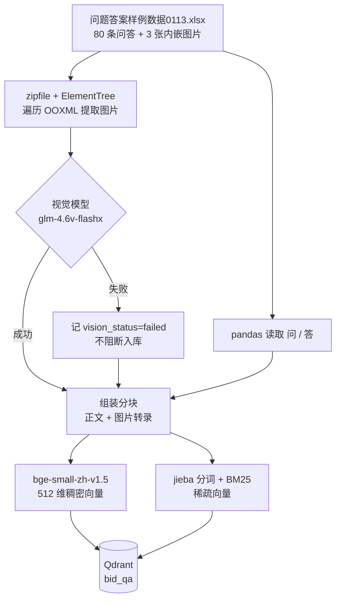
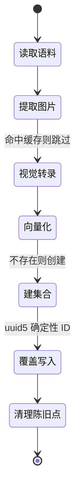

# 入库流程



## 分块单位：一行问答 = 一个分块

80 行 → 80 个分块，不做二次切分。两个理由：

1. 答案本身就是人工整理的完整条目，切开只会破坏语义；
2. 最长答案 500 字，而 bge 系列位置编码上限是 512 token（中文约 1 token/字）——
   最长那行已经贴着截断边界了，再切有害无益。

`pd.read_excel` 会读出 82 行，其中末尾一行全空，必须丢弃，否则会多一个空分块。

## 图片：为什么必须用视觉模型

第 52 行的问答是这样的：

| 列 | 内容 |
|---|---|
| 问 | 输出2023年上半年1-6月国内医院手机机器人招采情况详情 |
| 答 | 2023年上半年手术机器人招采情况如下： |

**正文只有一句引导语，真正的答案全在 3 张图里。** 不解析图片，这一行就是不可回答的。

`pd.read_excel` 只读单元格值，会**静默丢弃**内嵌图片。因此单独用
`zipfile` + `ElementTree` 遍历 OOXML：

```
xl/worksheets/_rels/sheet1.xml.rels   → 找到 drawing 部件
xl/drawings/drawing1.xml              → 锚点坐标 (row=51, col=1) + r:embed
xl/drawings/_rels/drawing1.xml.rels   → rId → xl/media/imageN.png
```

锚点 0 基行 51 → Excel 第 52 行 → 问答对序号 50 → `qa0113-0050`。

不用 openpyxl 的 `ws._images`，因为那条路需要 Pillow 才能物化 Image 对象
（本环境**没有装 Pillow**，实测确认），而我们要的恰恰是锚点坐标。

## 视觉结果缓存

图片按 sha1 缓存转录结果（`data/extracted/vision_cache.json`）。
重跑入库不再调用视觉模型——既省钱也更快。`--skip-vision` 可完全跳过，
得到一个只有文本的可用索引。

**视觉失败不阻断入库**：记为 `vision_status="failed"` 并继续。
第三方视觉 API 不该成为整条链路的单点故障。

## 幂等性



- **point ID 用 `uuid5(chunk_id)`**，完全确定性：重跑是覆盖而非堆积。
  不用 `uuid4`（每次都是新点，集合无限膨胀），也不用问题文本（改个标点就产生孤儿）。
- 入库后对比集合内 ID 与当前语料，删除已不存在的点。
- BM25 词表原子写入（先写 `.tmp` 再 `os.replace`），中断不会留下半截词表。

## 命令

```bash
uv run bidding-qa-chatbot ingest                 # 增量入库
uv run bidding-qa-chatbot ingest --recreate      # 重建集合（会清空数据）
uv run bidding-qa-chatbot ingest --skip-vision   # 跳过图片解析
```
