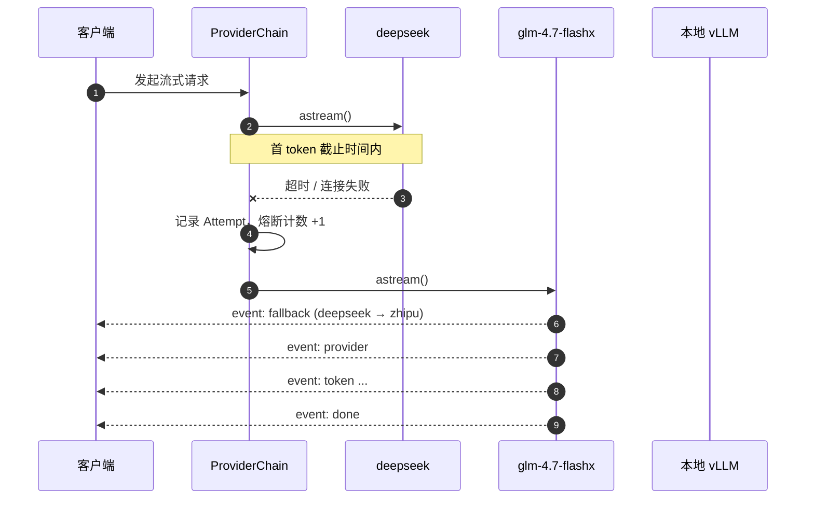
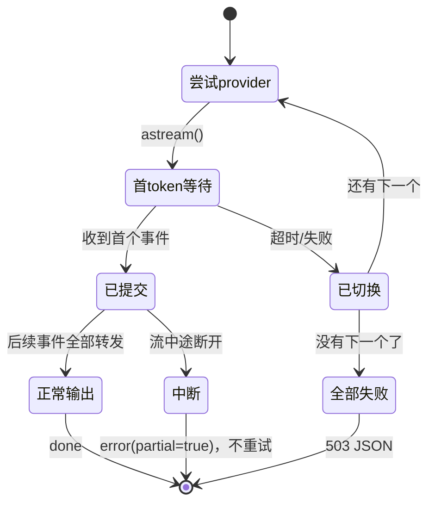

# 大模型接入与回退

## Provider 矩阵

| | DeepSeek | 智谱 | vLLM / Ollama |
|---|---|---|---|
| SDK | `openai` (2.x) | `zai-sdk` | `openai` (2.x) |
| base_url | `https://api.deepseek.com` | `https://open.bigmodel.cn/api/paas/v4/` | `VLLM_BASE_URL` |
| 默认模型 | `deepseek-flash` | `glm-4.7-flashx` | `VLLM_MODEL`（服务端路径） |
| 关闭思考 | `thinking: {"type":"disabled"}` | `thinking={"type":"disabled"}` | 不适用 |
| 思考文本 | `delta.reasoning_content` | 同左 | 同左 |

**两个容易踩的坑：**

1. **DeepSeek 的思考模式默认是开启的。** 快速模式若不显式传
   `thinking: {"type":"disabled"}`，每次「快速」回答都会白白付出推理延迟与费用。
   这一条有专门的测试断言请求体。
2. **`zai-sdk` 的默认 base_url 是国际站** `api.z.ai`，而 `.env` 里的 key 是国内站
   bigmodel.cn 的 `{id}.{secret}` 格式。所以代码里用的是 `ZhipuAiClient`
   （默认即 `open.bigmodel.cn`），并显式传 `base_url`。

## 回退链



### 唯一重要的不变量

**只有在首个 token 送达客户端之前，才能安全地换 provider。**

一旦已经吐字，重试就会产生重复或自相矛盾的文本。这一点由**代码结构**保证：
拿到首个事件之前的所有失败都走 `continue` 换下一个；拿到之后就没有回退分支了。



中途断开时**不重试**：已显示的文字保留，错误条出现在正文下方。
清掉用户已经读过的内容，比给一个不完整的答案更糟。

### 三档超时

| 档位 | 默认 | 作用 |
|---|---|---|
| `connect` | 5s（vLLM 2s） | 建连。本地服务连不上应当立刻失败 |
| `first_token` | 15s（思考模式 ×2.5） | **让故障切换「感觉瞬时」的关键旋钮** |
| `read` | 60s | 两个 token 之间的静默上限 |

首 token 超时远小于读超时，否则一个无响应的 provider 会让用户干等一分钟。

### 熔断

连续失败 `LLM_BREAKER_FAILURES`（默认 3）次后打开，窗口
`LLM_BREAKER_OPEN_SECONDS`（默认 60 秒）内直接跳过（零延迟），窗口过后放一次半开探测。
**中途断流的失败同样计数**——中途死三次的 provider 并不健康。

## 401 为什么也降级

需求是「线上调用失败时自动回退」。一个失效的 DeepSeek key 不该让用户拿不到答案，
所以 401/400 默认也走回退（`ChainConfig.fatal_falls_back = True`）。

但错误**不会被吞掉**：`Attempt` 会记进 `fallback` 事件与健康检查，
日志里也会有一条明确的 WARNING 指出哪个 provider 的凭证有问题。
需要严格模式时把该开关关掉即可。

## vLLM / Ollama

本机没有 NVIDIA GPU，vLLM 无法实际运行，因此：

- 未配置 `VLLM_MODEL` 时**直接跳过这一环**，不会每次都去连一个必然超时的地址；
- 连接超时设为 2 秒，连不上立刻失败；
- 健康检查会把它标为 `unavailable` 而不是报错。

`VLLM_MODEL` 是**服务端的文件系统路径**（如 `/root/autodl-tmp/...`），必须原样透传。

若想要一个真正能跑在本机的兜底模型，把 Ollama 加进链路：

```
LLM_FALLBACK_CHAIN=deepseek,zhipu,ollama,vllm
```

CPU 上跑 8B 模型很慢（个位数 token/秒），但可用。
