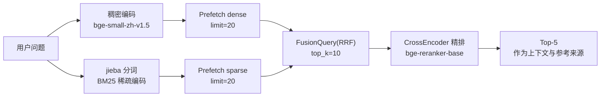
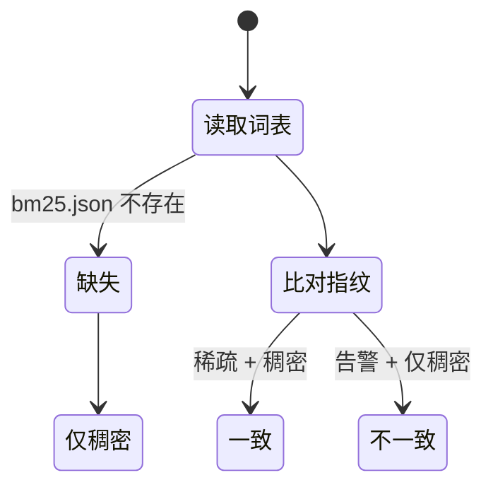

# 检索设计

## 集合结构（Named Vectors）

| 名称 | 类型 | 参数 | 作用 |
|---|---|---|---|
| `dense` | 512 维 float | Cosine | 语义召回 |
| `sparse` | SparseVector | 默认 | 词汇精确匹配 |

## 每段文本用的是什么

| 阶段 | 输入 | 理由 |
|---|---|---|
| 稠密（查询侧） | `指令前缀 + 用户问题` | bge-zh v1.5 是非对称模型，query 侧要加前缀 |
| 稠密（入库侧） | `问\n答`（原文，不加前缀） | 前缀两边不一致会让分数无声退化，所以前缀值放在 `Settings` 里共用 |
| 稀疏 | `问\n答` 的 jieba 分词 | 把问题也索引进去：用户以问句形式提问，招投标术语的词汇匹配精度很高 |
| 精排 | `(用户问题, 入库原文)` | **必须与入库文本完全一致**，否则会出现「召回高、精排低」的排序翻转，且原因不可见 |

## BM25 为什么自己算 IDF

Qdrant 支持服务端算 IDF（`Modifier.IDF`），代码更少。这里选择客户端算，因为：

- 离线单测（`QdrantClient(":memory:")`）能与线上行为**完全一致**；
- 服务端 IDF 依赖集合统计量，增量入库过程中是不稳定的；
- 语料只有 80 条且静态不变，客户端算的成本可以忽略。

IDF 用 `ln(1 + (N - df + 0.5) / (df + 0.5))` 而非 `ln(N/df)`：
后者在词覆盖全部文档时得 0，覆盖过半文档时为**负数**，而稀疏向量里的负权重
会直接把排序反转。招投标语料里「招标」几乎每篇都有，这不是假想问题。

## 词表一致性（最容易踩的坑）

词表一旦重建（换语料或换 jieba 词典），所有 term→index 映射整体平移，
**已入库的稀疏向量会全部失效，但不会报错**——因为 dense 一路照常工作，
结果看起来「有点对但不太对」。

防护措施：

1. 词表用 `sorted(unique_terms)` 生成，同样语料永远得到同样映射；
2. `vocab_sha1` 写进每个 point 的 payload 和集合元数据；
3. 查询前比对，不一致则**告警并降级为纯稠密检索**（`SPARSE_STRICT=true` 时直接报错）。

## 分数怎么用

- **RRF 分数**是排名融合的产物，量纲与余弦相似度不同，
  只能用于排序，**不能当置信度展示**（实测 qdrant-client 本地模式还会归一化，
  与服务端原始 `1/(k+rank)` 也不同）。
- **精排分数**才展示给用户，标为「相关性」。
  sentence-transformers 对单标签 CrossEncoder 会套一层 activation，
  `predict()` 返回的是 (0,1) 而非原始 logit，所以 `RERANK_MIN_SCORE` 默认 0.0
  （不截断），先观察真实分布再调阈值。

## 调参项（都在 `Settings` 里）

| 参数 | 默认 | 说明 |
|---|---|---|
| `RETRIEVAL_PREFETCH_DENSE` | 20 | 稠密候选池 |
| `RETRIEVAL_PREFETCH_SPARSE` | 20 | 稀疏候选池 |
| `RETRIEVAL_TOP_K` | 10 | 融合后进入精排的数量 |
| `RERANK_TOP_K` | 5 | 最终进入上下文的块数 |
| `RERANK_ENABLED` | true | 关闭可省 1-2 秒/次 |
| `RERANK_MIN_SCORE` | 0.0 | 0.0 表示不截断 |
| `MAX_CONTEXT_CHARS` | 6000 | 上下文预算，超限时**整块丢弃**而非截断正文 |
